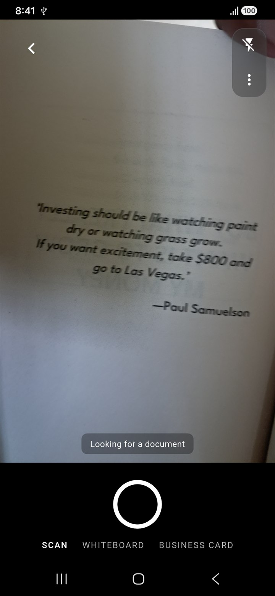
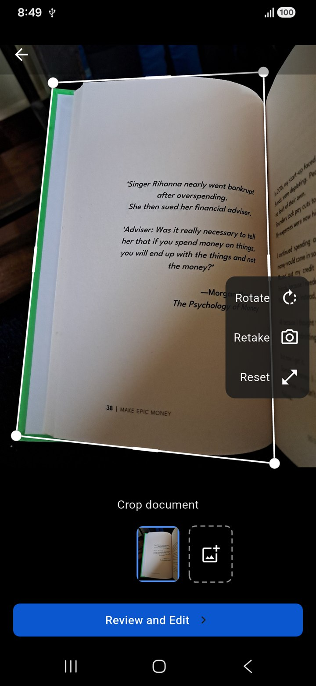
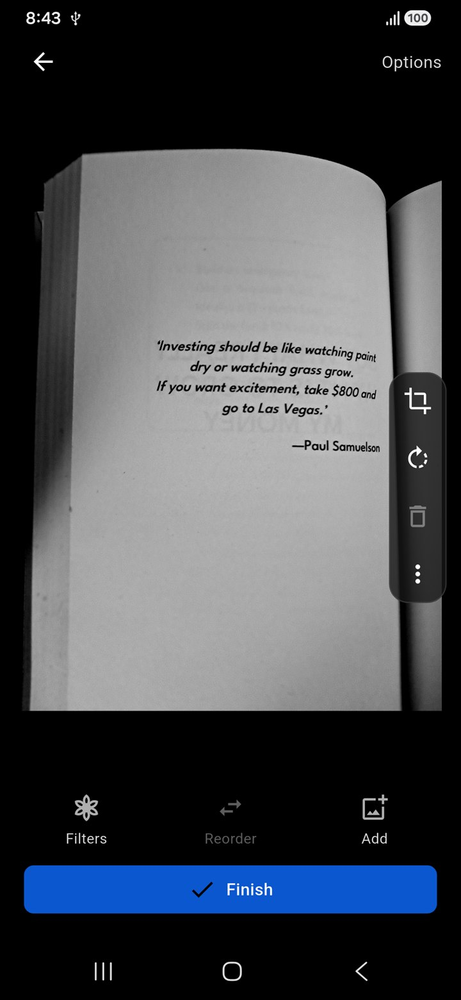
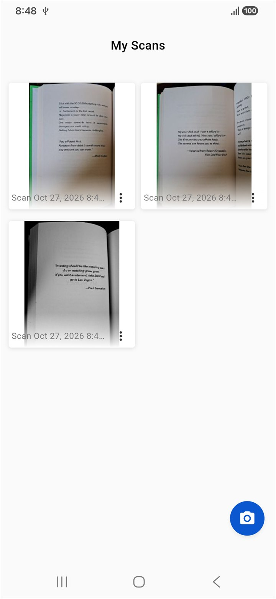

# Scan

A document scanner for Android that does one job: find the page, crop it, save a JPEG or a PDF.

No account, no ads, no "export up to 5 pages". The release build asks for the camera and your
photos, has **no `INTERNET` permission**, and there is no server anywhere for your scans to go.

<p align="center">
  
  
  
  
</p>

## Why this exists

Microsoft Lens was the app I reached for whenever I needed to keep something on paper. When its
scanning moved into OneDrive, I kept an old build running and went looking for a replacement. The
replacements wanted an account on someone's service, or a subscription past the fifth page, or
showed ads between the scan and the export.

So over a weekend I rebuilt the part I actually used, with [REA](https://www.npmjs.com/package/rea-agents)
doing the analysis and most of the typing. It is called Scan and it keeps exactly the flow I
missed: point, shoot, adjust the corners, save.

## What it does

- **Live page detection.** The outline of the page is drawn over the preview as you move, and the
  shutter fires on its own once the page holds still.
- **Multi-page.** Scan a stack; each page is a thumbnail in the filmstrip, and any of them can be
  retaken.
- **Corner editing.** Drag the four corners with a magnifier that keeps the corner clear of your
  finger, then rotate, filter, reorder or delete pages.
- **Export.** JPEG or PDF, written to `Pictures/Scan` and `Download/Scan` where other apps can see
  them, and shareable from the list.
- **The list is the folder.** Files dropped into the Scan folders show up next to the ones the app
  saved, and deletes only remove what the app owns.

## How it is built

Flutter UI over a single Kotlin bridge. Everything image-related stays on the platform side where
the APIs are.

| | |
|---|---|
| `lib/screens/` | capture, crop, review/edit, the scan list, the viewer |
| `lib/services/document_detector.dart` | page-corner detection — M-LSD 320 via `tflite_flutter` |
| `lib/services/native_image_kit.dart` | the Dart side of the one MethodChannel, `scan/image` |
| `lib/design/` | tokens, theme, shared controls; one blue accent, no dark variant |
| `android/.../ScanImageKit.kt` | `BitmapFactory`/`ImageDecoder`, `setPolyToPoly`, `ColorMatrix`, JPEG-in-PDF |

Two decisions worth knowing about, because both were arguments with the agent:

1. **The detector is a model, not hand-written code.** The first attempt was going to detect page
   edges by comparing brightness. That is a research project, not a weekend. ML Kit has no
   per-frame corner API — its Document Scanner is an Activity that owns the whole viewfinder — so
   the app bundles M-LSD 320 and its reference post-processing instead.
2. **The scope stayed small.** Every "while we're here" addition was turned down. One accent
   colour, one shutter, no dark mode, no account, no settings screen.

## Build

```powershell
flutter pub get
flutter build apk --release      # needs ANDROID_HOME
```

`flutter analyze` is clean. `flutter test` covers the detector and its corner guard, the quad
smoother, the exporter and the review screen. `integration_test/` holds the two on-device flows
(camera and PDF); they need a real camera, so they do not run on a host.

## The working notes

The design and the evidence behind it are in the repo, not in my head:

- [`docs/findings.md`](docs/findings.md) — what the analysis found: geometry, colours, thresholds,
  the saving model, with the resource names it came from.
- [`docs/plan.md`](docs/plan.md) — the measured design system, and the running log of what shipped.
- [`docs/story.md`](docs/story.md) — the longer version of the weekend, including what the agent
  got wrong.

No part of the original app — code, resources, assets or the APK itself — is included here. What is
included is the measurements and the reasoning.

## Licence and credits

MIT — see [LICENSE](LICENSE).

The corner detector is [M-LSD](https://github.com/navervision/mlsd) (Apache-2.0); the bundled model
and its licence are in `assets/models/`. Everything else — the icon included — is drawn from this
repo's own geometry.
